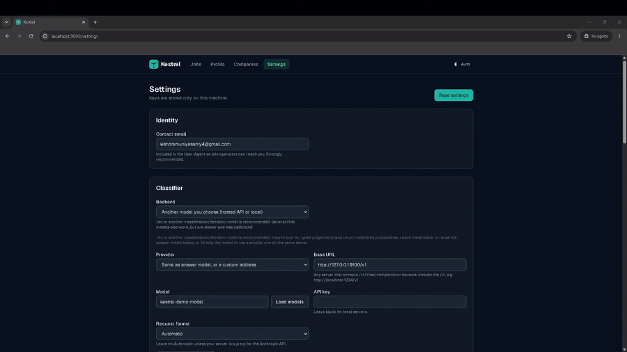

<p align="center"></p>

<p align="center"><strong>Self-hosted job matching that respects the sites it reads.</strong></p>

<p align="center"><a href="docs/demo.mp4"></a><br><sub><a href="docs/demo.mp4">Watch the full demo video</a></sub></p>

A kestrel hovers in place and picks out exactly one target. Kestrel does the same with job boards.
It reads openings from official job APIs and scores each one against your profile with a typed
classifier. Only roles that genuinely fit you reach your dashboard. When you decide to apply, it
drafts answers to the application form from *your own facts*, for you to review and copy.
It never applies for you.

- 🔎 **Official sources.** Reads the public Greenhouse, Lever and Ashby job boards, plus USAJOBS and Adzuna.
  It can also read careers pages you allowlist, using the job data those sites publish for search engines.
  A read-only browser is used only when a page has no such data.
  You can also add any RSS, Atom or JSON job feed a site publishes, with no code ([docs/SOURCES.md](docs/SOURCES.md#custom-feeds)).
- 🎯 **Precise matching.** Each job must first pass hard requirements: experience, required qualifications,
  location, work authorization and legitimacy. It then gets a weighted fit score with a confidence value.
  Only jobs with at least an 85% match score at 85% confidence are shown, sorted into **Strong / Good**,
  and you can see why each one matched, which of your skills
  it asks for, and which ones you're missing.
- 👍 **Learns your taste.** Give a thumbs up or down and future matches lean toward the jobs you liked.
- 📋 **Application tracker.** Track each job through Saved → Applied → Interviewing → Offer, with private notes.
  Jobs found since your last visit get a "New" badge.
- ✍️ **Grounded answer suggestions.** Answers use only facts from your profile. Anything missing becomes a
  `[fill in: …]` placeholder. Demographic and EEO questions are never drafted, and Kestrel refuses to draft
  for employers who ask applicants not to use AI.
- 🛡️ **Compliance first.** No auto-apply. A hard denylist of sites that forbid bots. It follows robots.txt,
  rate limits, an honest User-Agent and attribution rules, and keeps a full audit log.
  See [docs/COMPLIANCE.md](docs/COMPLIANCE.md).
- 🔒 **Private.** Runs on your machine, and your data stays in a local SQLite file. Bring your own keys, or use local models.

## Quick start

You need [uv](https://docs.astral.sh/uv/) (Python) and [Node.js](https://nodejs.org) 20 or newer.

```bash
git clone https://github.com/KishoreXO/kestrel-jobs
cd kestrel-jobs
```

Then start it:

| System | Command |
|---|---|
| **Windows** | Double-click **`start.cmd`**, or run `.\start.cmd` in a terminal |
| **macOS / Linux** | `./start.sh` |
| **Docker** | `docker compose up --build` |

The dashboard opens at **http://localhost:3000**. A setup checklist walks you through the rest:

1. **Settings.** Add your contact email and pick a classifier. Use **Save & test connection** to check it works.
2. **Profile.** Upload your resume and review the extracted profile. Target titles and skills matter most.
3. **Companies.** Pick employers from the **starter pack**, or paste any Greenhouse, Lever or Ashby careers URL.
4. Click **Scan now**. New postings are classified and sorted into tiers.
5. Open a job, click **Open original posting** and apply on the employer's site. Use **Help me answer** for suggestions you can copy.

<details>
<summary>Starting it by hand instead</summary>

Use two terminals:

```bash
cd backend
uv sync
uv run kestrel          # API on http://127.0.0.1:8000
```

```bash
cd frontend
npm install
npm run build
npm start               # dashboard on http://localhost:3000
```

On Windows PowerShell, use `npm.cmd` in place of `npm` if script execution is disabled.
</details>

## Models: any model you like

Kestrel works with any model: a hosted API or one running on your own computer. Settings has
one-click presets for Ollama, LM Studio, llama.cpp, vLLM, Anthropic, OpenRouter, Groq, Mistral, Together,
DeepSeek, Gemini and others. Or choose **Custom address** and enter any server that accepts the common
`/v1/chat/completions` request format. **Load models** lists what the server offers, and
**Save & test connection** tells you in plain words if something is wrong.

API keys stay on your machine. A saved key is only ever sent to the address it was saved for: switching
provider removes it.

| Job | Recommended | Or use |
|---|---|---|
| Classifying jobs | **[Jev](https://docs.typesafe.ai) by TypeSafe**. It is built for typed yes/no, choice and score questions, returns calibrated probabilities, and is fast and cheap per decision. | Any model you choose (`CLASSIFIER=llm`) |
| Reading careers pages that only render in a browser (optional) | **[Cua Driver](https://github.com/trycua/cua)**. It drives a real browser in the background with an isolated profile and has a read-only tool allowlist. | Headless Playwright Chromium (`BROWSER=playwright`) |
| Drafting answers, importing resumes, skill gaps | Your pick | Any model you choose |

## How matching works

1. **Local prefilter.** A free keyword check drops obviously unrelated titles and the companies or keywords you excluded.
2. **One classifier call per job.** The classifier answers narrow typed questions:
   - yes/no gates: experience, required qualifications, location, work authorization, genuine posting, and an AI-policy flag
   - score rubrics: title, skills, seniority, domain and preference fit (your 👍/👎 history feeds the preference fit)
   - one choice: seniority level
3. **Decision in code.**
   - Any failed gate rejects the job, and the reason is shown.
   - Otherwise the fit scores are combined into a weighted score.
   - A job is shown only when the score is at least 0.85 **and** the classifier is at least 85% confident;
     everything else is filtered out with its score in the reason. Strong is ≥ 0.92, Good is ≥ 0.85.
   - The classifier is told the same rule: only jobs with at least an 85% confidence score are returned.
4. **Caching.** A job is classified again only when the posting or your profile changes.

## Project layout

```
backend/   Python API and scanner (sources/, classify/, answers/, browse/, compliance/)
frontend/  web dashboard
docs/      COMPLIANCE.md, SOURCES.md
start.cmd  start.sh   one-command launchers
```

## License

MIT. Job data belongs to its publishers. Follow each source's terms ([docs/SOURCES.md](docs/SOURCES.md)).
